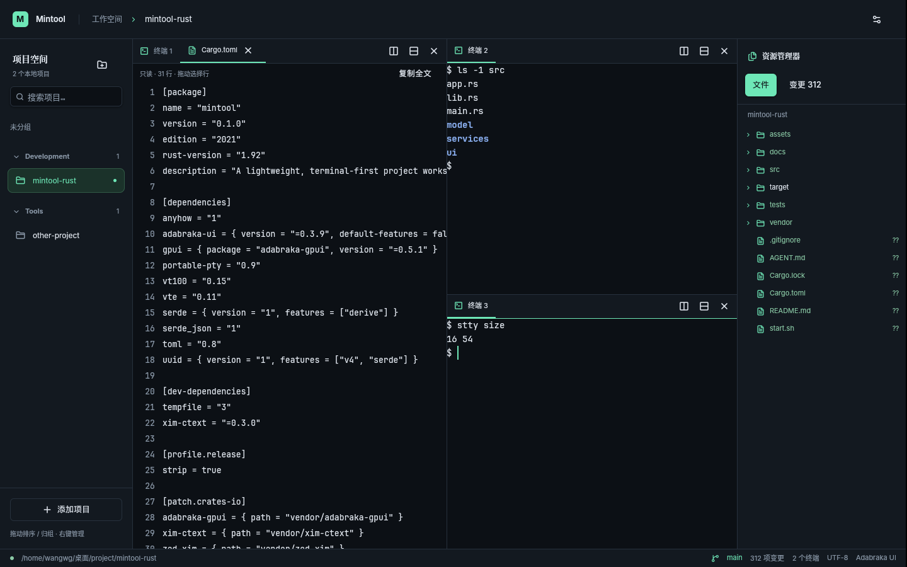

# Mintool

当前版本：**v0.2.1**。软件顶部及窗口标题显示版本；`mintool --version` 可查询安装版本。

以终端为核心的 Rust 桌面项目工作台。第一版面向 Linux，采用 [Adabraka UI 0.3.9](https://github.com/Augani/adabraka-ui) 原生界面、[GPUI Component 0.5.1](https://crates.io/crates/gpui-component/0.5.1) Dock、portable-pty 和 VT100 终端解析，无需 WebView。



[添加项目与分组选择](docs/add-project.png) · [项目右键菜单](docs/project-menu.png) · [挂载目录选择](docs/directory-picker.png)

## 运行

需要 Rust 1.92+、C 链接器和可用的 Linux 图形桌面。Git 功能依赖系统 `git`；中文显示需要系统中文字体。目录选择器使用应用自身的文件系统权限，直接浏览本地目录、挂载点和目录链接，不依赖系统 Portal 的目录列表。启动时默认最大化，恢复窗口后可自由调整大小。

```bash
./start.sh
# 启动并添加/选中指定目录
./start.sh /path/to/project
# 也可以通过 Cargo 启动
cargo run --release --locked
```

Adabraka GPUI 在 Linux 上通过 Vulkan 绘制，需要可用的图形驱动。Ubuntu 的基础构建依赖可通过以下命令安装：

```bash
sudo apt install clang libfontconfig-dev libwayland-dev libxkbcommon-x11-dev \
  libx11-xcb-dev libssl-dev libzstd-dev libvulkan-dev libdbus-1-dev
```

`start.sh` 默认把编译缓存放在 `~/.cache/mintool-target/`，也可通过 `CARGO_TARGET_DIR` 指定；构建后可直接运行该目录下的 `release/mintool`。直接使用 Cargo 构建时，产物仍在 `target/release/mintool`。

## 本地安装

```bash
./install.sh
~/.local/bin/mintool --version
```

安装脚本构建锁定依赖的 release 版本，将程序安装到 `~/.local/bin/mintool`，并注册应用菜单和图标。可从应用菜单搜索 **Mintool** 启动；如果 `~/.local/bin` 已在 PATH 中，也可以直接运行 `mintool`。重复执行可更新安装，保留 `~/.mintool/` 中的项目、布局和设置。

`v0.2.1` 新增 Dock 标签组与自由分屏、终端滚动条、终端进程生命周期清理、系统终端嵌入和终端图片粘贴；修复终端输出期间缩放导致的解析崩溃，并优化项目切换与文件预览的重复 I/O 和大对象复制。

当前开发版新增最左侧模块栏（项目 / SSH / Docker）、独立的 SSH 连接管理与 SSH 会话（系统 `ssh`、密钥/密码、`~/.ssh/config` 导入、同一连接多会话）、SSH 双栏文件传输和本地 Docker 容器管理；运行时会话按模块隔离，配置迁移到 `~/.mintool/modules/`。

## Debian / Ubuntu 安装包

```bash
./package-deb.sh
```

产物为 `dist/mintool_0.2.1-1_amd64.deb`（架构随构建机变化），同时生成 SHA-256 校验文件。构建依赖 `dpkg-dev` 和 `desktop-file-utils`；安装包声明程序的运行依赖，并包含 PNG/SVG 图标、系统应用菜单入口和图标缓存更新脚本。当前包在 Ubuntu 26.04 amd64 上构建，其他发行版需要满足包内的动态库版本要求。

如果之前运行过 `install.sh`，先把旧的用户安装移到备份目录，避免它优先于安装包的程序及桌面入口：

```bash
mkdir -p ~/.local/share/mintool-local-backup
[ ! -f ~/.local/share/applications/mintool.desktop ] || mv ~/.local/share/applications/mintool.desktop ~/.local/share/mintool-local-backup/
[ ! -f ~/.local/bin/mintool ] || mv ~/.local/bin/mintool ~/.local/share/mintool-local-backup/
sudo apt install ./dist/mintool_0.2.1-1_amd64.deb
```

之后从应用菜单搜索 **Mintool**，或运行 `/usr/bin/mintool`。包管理器负责升级与卸载；用户项目、布局和主题设置仍保存在 `~/.mintool/`，不由安装脚本修改。

## 已实现

- 最左侧是模块栏，当前包含“项目”“SSH”和“Docker”；点击当前模块可收起或展开它的侧栏（再次点击恢复），切换模块保留各自的选中项、会话与布局。
- SSH 连接列表与项目列表并列但完全分开：支持分组、搜索、拖拽排序/归组、右键连接/新建终端/编辑/复制/移动/删除，以及从 `~/.ssh/config` 导入具体 Host。
- SSH 连接使用系统 `ssh` 命令运行在现有 PTY 终端中：支持主机别名、端口、用户名、私钥、密码和高级参数（例如 `-L` 端口转发），同一连接可开多个终端标签或分屏，断开后可点击“重新连接”。连接列表单击只选中，双击或右键“连接”才打开会话；切换模块不会自动连接。
- SSH 连接弹窗提供“测试连接”：直接使用当前表单值、12 秒超时、自动记录新主机密钥，并在弹窗内显示成功或具体 ssh 错误。
- 密码按你的要求保存到配置文件中，文件权限为仅当前用户可读（0600）；不填密码时使用密钥、ssh-agent 或终端内提示。SSH 配置位于 `~/.mintool/modules/ssh/registry.json`，注意其中的密码为明文。
- 打开 SSH 会话后，右侧变为类似 Xftp 的双栏文件传输面板：左侧本地文件系统、右侧远端 SFTP 目录；两侧都有可点击的路径面包屑、后退、上一级、主目录和刷新。双击目录进入，双击远程文件在 Dock 中打开只读预览；选中文件后可用“上传 →”“← 下载”在两侧当前目录之间传输，重名会自动加序号。远程右键还支持复制路径、下载到系统下载目录和在终端中进入该目录。
- Docker 模块列出本地容器和镜像：双击容器打开 `docker logs -f` 会话，右键进入 `docker exec` 终端、启动/停止/重启/暂停/恢复/删除；支持搜索、每 3 秒自动刷新、复制容器 ID/名称和镜像名称。每个容器的日志/终端会话有独立 Dock 布局，随会话保存。
- Docker 使用系统 `docker` CLI，自动遵循 `DOCKER_HOST` 和 rootless 配置，也可用 `MINTOOL_DOCKER_BIN` 指定 docker/podman 可执行文件；daemon 未启动或 socket 权限不足时会在侧栏给出明确错误。
- 添加项目时可选择所属分组；分组右键可直接添加到该分组。目录选择器只回填路径，确认后才添加；无效路径、空名称、重复分组名会在弹窗内提示。
- 目录选择器支持上一级、主目录、显示隐藏目录，以及输入路径后按 Enter 进入。单击选中、双击进入，可选择当前目录或选中的子目录，包含 FUSE 等挂载目录。
- 项目右键可打开项目、新建终端、在文件管理器中打开、复制路径、重命名、重新定位目录、移动归组、上下排序及移除。分组右键可添加项目、折叠展开、重命名、上下排序及删除；左侧空白处右键可添加项目/分组、展开或折叠全部分组。
- 删除分组和移除项目均需确认，保留磁盘文件；删除分组将其项目移到“未分组”，运行中的终端继续保留。
- 拖动项目行到另一项目前排序，拖到分组名称归组，拖到“未分组”移出分组；分组也可以拖到另一分组名称前排序。右键菜单提供移动到分组操作。
- 每个项目/SSH 连接独立保存工作区，切换时保留已经启动的终端及后台任务。中间布局直接复用 GPUI Component 的 Dock：点击按钮上下/左右拆分，拖动标签到另一组的标签栏合并为标签组，拖到内容区边缘重新停靠分屏，拖动分隔线调整尺寸；至少保留一个面板。分组顺序、选中标签、拆分方向和尺寸自动保存，旧版分屏首次打开自动转为 Dock。
- 中间工作区及终端内容无额外外边距、内边距或圆角卡片边框，面板直接铺满可用空间，仅保留操作栏和拆分线。
- 每个终端标签自带关闭按钮，支持标签中键关闭；关闭最后一个终端后保留空面板，可点击“新建终端”。关闭终端、重启终端、移除项目和退出软件都会清理关联进程：先请求退出，再强制结束未退出进程，并释放其监听端口。每个终端携带独立的进程归属标记，结合会话、进程组和后代关系追踪后台任务（包括继承标记的 `setsid` 服务）；按进程身份和 pidfd 发送信号，不扫描端口后随意杀进程。独立交给系统服务管理器运行的服务不属于终端进程清理范围。
- 项目终端初始目录为项目根目录，SSH 终端在本地主目录启动 `ssh`；终端支持 ANSI 颜色、宽字符、中文输入法提交、滚动历史与可拖动滚动条、方向键、控制键、括号粘贴和基本终端查询。点击终端获取键盘焦点。
- 点击文件，在当前面板中直接以可编辑缓冲区打开 UTF-8 文本（行号、按扩展名语法高亮、中文输入法），也可切换 Markdown／HTML 富文本预览；支持 PNG、JPEG、WebP、GIF、SVG、BMP、TIFF 等常见图片。编辑内容用 Ctrl+S 保存到原文件；关闭标签页或退出软件时，如有未保存修改会提示保存、不保存或取消。文本文件最多 2 MiB；普通图片最多 20 MiB、1600 万像素，动图最多 8 MiB、400 万像素，超过限制会提示而不解码，避免异常占用内存。
- 右侧文件树和 Git 变更视图；变更用颜色和 Git 两列状态表示，目录继承子文件状态，删除文件仍出现在变更视图中。后台查询约每 2 秒更新 Git；资源树使用系统原生文件事件监听（Linux 为 inotify），按需监听项目根目录、可见的展开目录和打开文件所在目录；外部新增、删除、重命名及内容修改触发局部缓存失效与刷新，连续事件合并处理，不定时扫描目录。
- 每个终端最多保留 2000 行滚动历史；切换项目时释放旧项目的文件目录缓存、文本和图片预览、Git 明细，图片预览关闭后同步释放 GPUI 图片缓存，减少长期运行的内存占用。
- 文件、目录及资源树空白处均有右键菜单：预览、在文件管理器打开目录、在当前目录新建终端、新建文件／文件夹、复制完整路径／相对路径／名称、创建文件副本、重命名、移到回收站、刷新和折叠。重命名同步更新已打开文件路径；回收站操作需确认，依赖系统 `gio`，失败会提示，保留原文件。
- 文件图标按代码、配置、Markdown、图片、压缩包、数据库、脚本和媒体类型区分形状与颜色，目录使用独立图标。
- 底部显示目录、Git 分支、变更数量和当前项目的终端数量。
- 顶部工具栏可直接切换深色／浅色主题，终端、资源树、文件预览和弹窗同步生效，自动保存并在下次启动恢复。
- 设置终端后端、默认 Shell 和内置终端字号。后端默认自动选择已安装且支持嵌入的系统终端（Alacritty、xterm、urxvt、st），也可手动选择；系统终端需要 X11，自动模式无可用项或当前为原生 Wayland 窗口时使用内置终端。Konsole、Ptyxis 没有上述命令行嵌入接口，不列为可选后端。系统终端点击后会把 X11 键盘焦点交给最内层输入窗口，并为 Dock 分割线保留可见、可拖动的间隔；xterm 默认使用中文字体回退，选区自动进入 CLIPBOARD，选中链接后可点击终端标签栏的“打开链接”按钮调用系统浏览器。设置对新建终端生效，现有会话保留；系统终端的字体和颜色沿用其自身配置。项目列表、分组、选中项目、分屏比例、文件标签、文件树展开状态和侧栏宽度自动保存。
- 窗口缩放时侧栏限制占用宽度，主要空间留给工作区，分屏按保存比例重新计算；搜索框适应侧栏宽度，窄面板使用紧凑标签，路径和长名称自动截断。

内置后端的终端界面由应用绘制，通过 PTY 运行设置中的系统 Shell；系统终端后端则以 X11 子窗口嵌入对应面板，复制粘贴、输入法和终端协议由所选程序处理。以下快捷键说明针对内置后端。支持鼠标划选，松开鼠标即自动复制到系统剪贴板，移出终端后松开也生效；单击不会覆盖剪贴板。Ctrl+C 在有选区时复制选区，否则发送中断。Ctrl+V / Ctrl+Shift+V 或右键粘贴文本，Shift+Enter 发送换行；剪贴板为图片时，Ctrl+V 透传给终端内程序，由该程序处理图片粘贴，Ctrl+Shift+V 则将图片保存为临时文件并粘贴经过 Shell 引号转义的路径。图片文件在对应终端面板关闭或重启时清理。Ctrl+Shift+C 复制选区或当前可见终端内容。尚未实现终端鼠标报告、终端内图片显示协议和完整终端模拟器兼容性；复杂 TUI 的具体交互仍需继续实测。

退出后恢复模块、布局、文件和上次选中的项目或 SSH 连接；终端在打开对应项目/连接时重新启动，进程与历史输出不跨应用退出恢复。关闭面板、移除项目、重新定位目录或退出应用会关闭对应终端。重新定位保留工作区布局，并调整项目内文件的保存路径。

## 配置

默认目录为 `~/.mintool/`，不会在项目里创建配置目录。

```text
~/.mintool/
├── config.toml
├── modules/
│   ├── projects/
│   │   ├── registry.json
│   │   └── sessions/<项目 UUID>.json
│   ├── ssh/
│   │   ├── registry.json          # 权限 0600，可能包含明文密码
│   │   └── sessions/<连接 UUID>.json
│   └── docker/
│       └── sessions/<容器会话>.json
└── logs/
```

首次启动会自动把旧的 `projects.json` 和 `workspaces/*.json` 读取并复制到 `modules/projects/`，旧文件保留作为回退。

连续修改合并后自动写入，使用临时文件替换并保留 `.bak`；配置损坏时从有效备份恢复，并另存损坏文件。配置及备份都无效时报告错误，避免静默覆盖。相同配置目录只允许一个实例运行。

`config.toml` 示例：

```toml
appearance = "dark" # dark / light
font_size = 14.0
shell = "/bin/bash"
left_width = 210.0
right_width = 270.0
ssh_right_width = 520.0
active_module = "Projects" # Projects / Ssh / Docker
projects_sidebar = true
ssh_sidebar = true
docker_sidebar = true
```

需要隔离运行时，可以指定其他配置目录：

```bash
MINTOOL_CONFIG_DIR=/tmp/mintool-demo target/release/mintool /path/to/project
```

## 开发与验证

```bash
cargo fmt --package mintool --check
cargo clippy --all-targets --locked --no-deps -- -D warnings
cargo test --locked
cargo build --release --locked
```

`src/modules/` 按业务模块划分：`projects/` 保存项目注册表、侧栏和菜单，`ssh/` 保存连接注册表、导入、侧栏、对话框、ssh 启动参数和 SFTP 传输，`docker/` 保存 Docker CLI、容器/镜像列表与会话，公共的分组/会话抽象在 `common/`；`src/workspace/` 是与模块无关的会话运行时（Dock、分屏、终端/文件面板生命周期）；`src/shell/` 是最左侧模块栏、工具栏和状态栏；`src/services/` 保存配置存储、PTY、Git 等基础服务；`src/ui/` 放置通用弹窗、主题、文件树与终端绘制；`src/app.rs` 负责组合。

后续大模块（Docker、数据库、本机服务等）的架构与实施顺序见 [docs/modules-roadmap.md](docs/modules-roadmap.md)。

集成测试覆盖拖动对应的数据操作、分屏合并与序列化、配置锁与备份恢复、模块存储迁移、SSH 注册表/命令构建/配置导入、真实 Git 状态，以及真实 PTY 的工作目录隔离、后台运行、中断和尺寸同步。当前只在 Linux 上验证；尚未验证 Windows/macOS。

## 上游 Linux 构建修补

当前使用 `adabraka-ui 0.3.9` 和 `adabraka-gpui 0.5.1`。已在 `vendor/adabraka-gpui/` 修复上游 X11 模块的缺失导入、关闭窗口时的重复借用，以及 Linux GPU 结构体对齐问题，并保留原许可证和 X11 支持。完整来源和修改见 [vendor/README.md](vendor/README.md)。

依赖锁文件保留 `libc 0.2.186`，避免上游旧版 `xattr` 与更新版本的符号变更冲突。请使用现有锁文件构建；项目使用本机的稳定版 Rust 完成验证。

中文输入法使用的 `xim-ctext` 和 `zed-xim` 也保留了本地修补：支持中文预编辑消息中的 GB2312 等编码切换，并将解码失败从 panic 改为可处理的错误，避免输入中文时闪退。来源和修改同样记录在 [vendor/README.md](vendor/README.md)。
